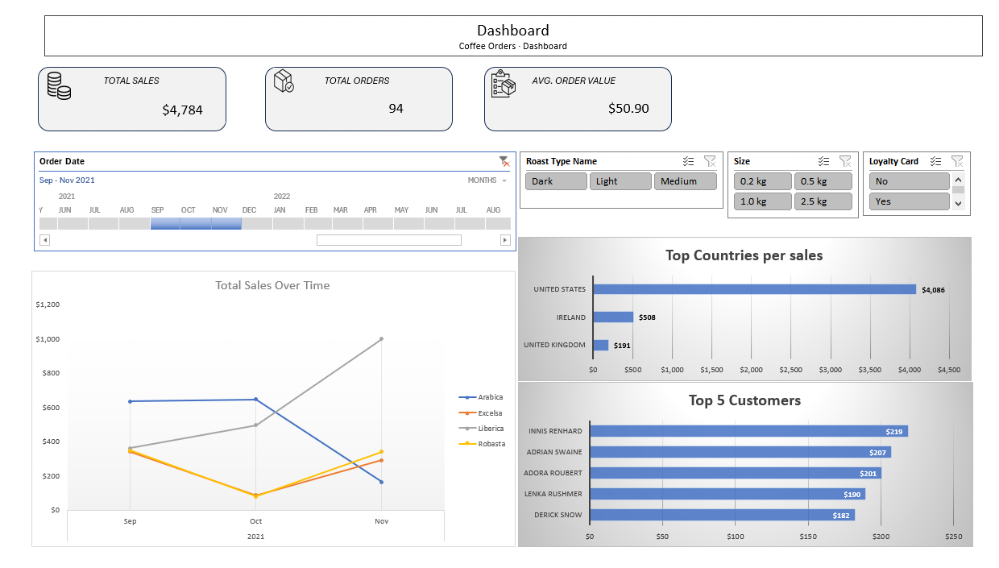
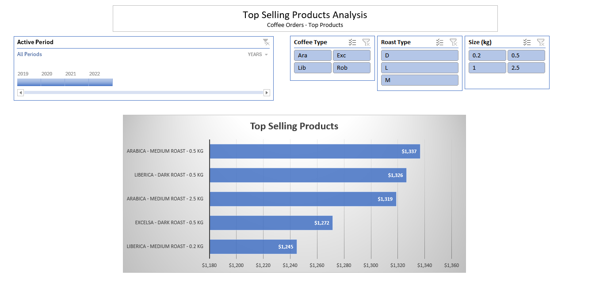
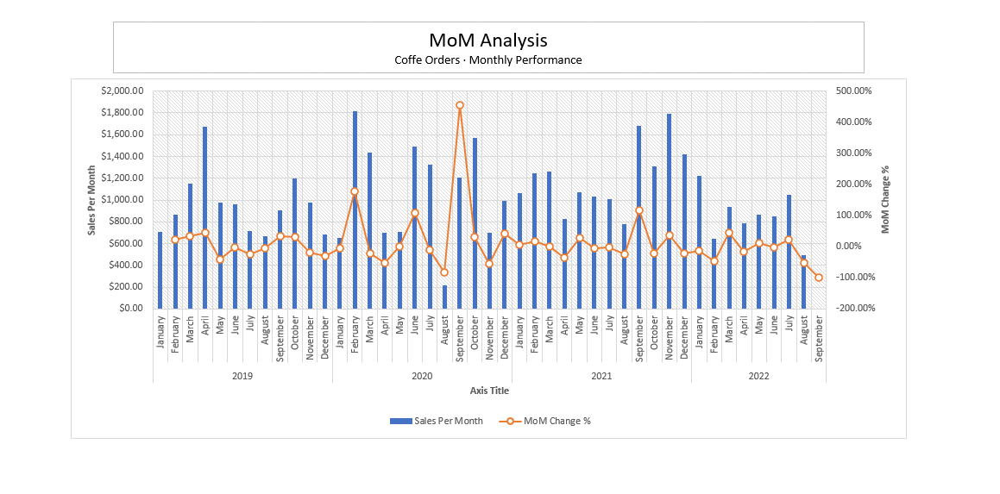

# ☕ Coffee Orders Sales Dashboard

## Overview

An interactive sales dashboard built in Microsoft Excel to analyze coffee shop order data and explore sales performance over time.

The dashboard provides a visual overview of sales trends, coffee product performance, and order distribution. It uses PivotTables, PivotCharts, and interactive slicers to make it easier to explore the data and identify patterns.

## 📸 Project Screenshots

### 📊 Sales Dashboard

### 🏆 Top-Selling Products

### 📈 Month-over-Month (MoM) Sales Analysis

## Dashboard Features

- **Sales Over Time:** Track sales trends and compare performance across different coffee products.
- **Sales by Coffee Type:** Compare sales across Arabica, Excelsa, Liberica, and Robusta.
- **Sales by Size:** Analyze sales distribution across different coffee sizes.
- **Interactive Filters:** Filter the dashboard by order date, roast type, size, loyalty card status, and other available categories.
- **Dynamic Visualizations:** Explore the data through PivotCharts that respond to the selected filters.

## Tools & Skills

- **Microsoft Excel** — Data analysis and PivotTables
- **Power Query** — Data cleaning and transformation
- **Power Pivot** — Data modeling and relationships
- **DAX** — Measures, previous-month sales, and MoM analysis
- Interactive slicers and filters
- XLOOKUP
- Excel formulas and lookup functions
- Sales data analysis
- KPI calculations
- **Data Visualization** — Charts for product performance and monthly sales trends

## Business Questions

This dashboard can help explore questions such as:

- How do coffee sales change over time?
- Which coffee types generate the highest sales?
- How does sales performance vary by coffee size?
- Are there seasonal patterns in sales?
- How do different roast types and customer segments affect sales performance?
- How does sales activity change when filtering by loyalty card status?

## 📊 Sales Analysis & Business Insights

### 🏆 Top-Selling Products
- Identified and ranked top-selling products based on sales performance.
- Compared product sales to highlight best-selling items.
- Used visualizations to communicate product performance and support data-driven decisions.

### 📈 Month-over-Month (MoM) Sales Analysis
- Analyzed monthly sales trends to identify growth and decline.
- Created a calendar table to support time-based analysis, including months with no orders.
- Calculated previous-month sales using DAX time-intelligence functions.
- Calculated MoM sales change to measure the difference between current-month and previous-month sales.
- Visualized monthly sales performance to monitor trends over time.

## Dataset

The dataset contains coffee order information, including order dates, coffee types, roast types, sizes, and other product and customer attributes.

**Data source:** https://github.com/mochen862/excel-project-coffee-sales

## How to Use

1. Download `coffee-sales-dashboard.xlsx` from this repository.
2. Open the workbook in Microsoft Excel.
3. Use the slicers and filters to select the date range and categories you want to analyze.
4. Explore the charts to compare sales trends and product performance.

Microsoft Excel desktop is recommended for the full interactive experience.

## What I Learned

Through this project, I practiced:

- Creating PivotTables to summarize sales data
- Building PivotCharts to visualize business metrics
- Using slicers to create interactive reports
- Using XLOOKUP to retrieve matching values across tables
- Applying Excel lookup functions to retrieve product information
- Organizing dashboard elements into a clear, user-friendly layout
- Presenting sales data to support business analysis

## Future Improvements

- Calculate and document key business insights
- Improve the analysis of sales trends and periods with no recorded sales
- Recreate the dashboard in Power BI
- Explore the dataset using SQL and Python

## Credits

This project was inspired by a YouTube tutorial.

**Original tutorial:** (https://www.youtube.com/watch?v=m13o5aqeCbM)

The tutorial provided the starting point for this project and helped me practice Excel data analysis and dashboard development.

## Author

Aspiring Data Analyst building practical projects in Excel, SQL, Python, and data visualization.
